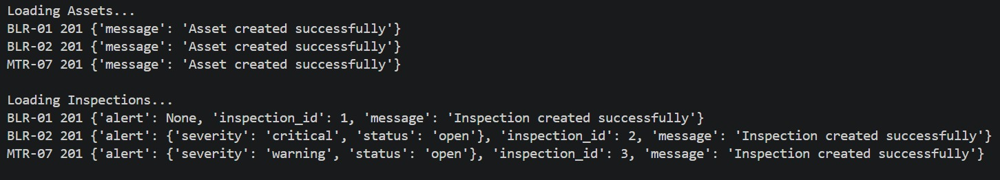
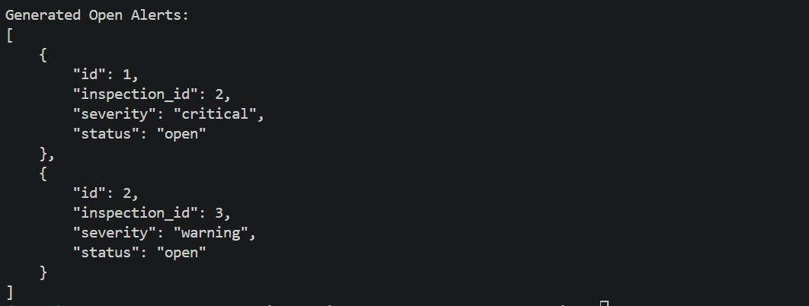
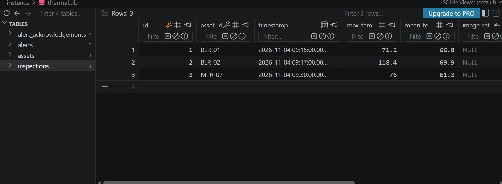
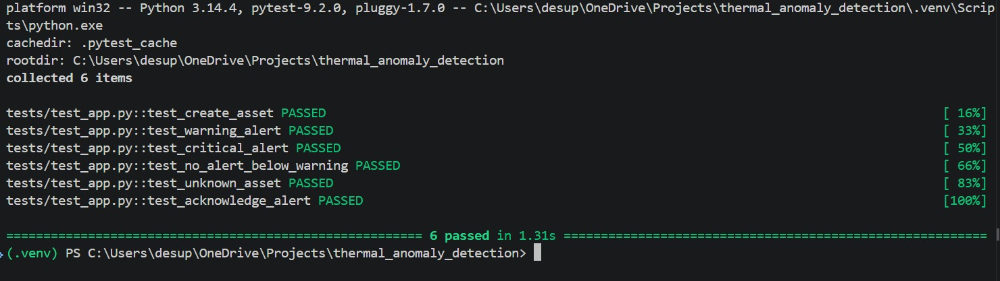

# Thermal Anomaly Detection API

A Flask-based REST API for managing industrial assets, recording thermal inspections, automatically generating temperature-based alerts, and tracking alert acknowledgements.

## 1. Project Overview

The objective of this assignment is to develop a backend system that monitors the thermal condition of industrial assets.

The system allows users to:

- Register and retrieve industrial assets.
- Record thermal inspections for registered assets.
- Automatically generate warning or critical alerts based on temperature thresholds.
- Retrieve inspection history for individual assets.
- View currently open alerts.
- Acknowledge alerts while maintaining an audit trail.

The application is built using Flask and Flask-SQLAlchemy, with SQLite as the database.

## 2. Technology Stack

| Technology | Purpose |
|---|---|
| Python | Backend programming |
| Flask | REST API development |
| Flask-SQLAlchemy | Database ORM |
| SQLite | Database storage |
| Pytest | Automated API testing |
| Requests | Sample data loading |

## 3. Database Design

The application uses four database models.

### 3.1 Asset

Stores information about industrial equipment.

| Field | Description |
|---|---|
| asset_id | Unique asset identifier |
| name | Asset name |
| type | Asset category |
| location | Physical location |
| warning_limit_C | Warning temperature threshold |
| critical_limit_C | Critical temperature threshold |

### 3.2 Inspection

Stores thermal inspection records associated with assets.

| Field | Description |
|---|---|
| id | Inspection primary key |
| asset_id | Associated asset |
| timestamp | Inspection date and time |
| max_temp_C | Maximum recorded temperature |
| mean_temp_C | Mean recorded temperature |
| image_ref | Reference to inspection image/data |
| idempotency_key | Unique key to prevent duplicate inspections |

### 3.3 Alert

Stores alerts generated from inspection results.

| Field | Description |
|---|---|
| id | Alert primary key |
| inspection_id | Associated inspection |
| severity | Warning or critical |
| status | Open or acknowledged |

### 3.4 AlertAcknowledgement

Maintains the acknowledgement history of alerts.

| Field | Description |
|---|---|
| id | Acknowledgement record ID |
| alert_id | Associated alert |
| previous_status | Status before acknowledgement |
| new_status | Status after acknowledgement |
| acknowledged_by | Person acknowledging the alert |
| acknowledged_at | Acknowledgement timestamp |

## 4. Implementation Approach

### 4.1 Asset Management

The application provides endpoints to create, retrieve, and update industrial assets.

When an asset is created, its identification, location, and temperature thresholds are stored in the database. These thresholds are later used when evaluating thermal inspection records.

### 4.2 Inspection Management

When an inspection is submitted, the API:

1. Reads the inspection details from the request.
2. Checks whether the idempotency key has already been used.
3. Verifies that the associated asset exists.
4. Creates and stores the inspection record.
5. Compares the maximum temperature against the asset's configured thresholds.
6. Generates an alert when the temperature reaches or exceeds the warning threshold.
7. Returns the inspection result and any generated alert.

Inspection history for an asset is retrieved in descending timestamp order, so the latest inspection appears first.

### 4.3 Automatic Alert Generation

Alert severity is determined using the maximum temperature recorded during an inspection.

The application follows this decision logic:

| Condition | Generated Alert |
|---|---|
| `max_temp_C >= critical_limit_C` | Critical |
| `max_temp_C >= warning_limit_C` | Warning |
| `max_temp_C < warning_limit_C` | No alert |

The critical condition is checked first to ensure that critical temperatures are not classified as ordinary warnings.

Every newly generated alert starts with an `open` status.

### 4.4 Idempotency

To prevent duplicate inspection records, the application uses an idempotency key.

Before creating an inspection, the API checks whether the submitted key already exists.

- If the key is new, the inspection is processed normally.
- If the key already exists, the existing inspection ID is returned instead of creating another record.

This helps prevent duplicate records when the same request is submitted more than once.

### 4.5 Alert Acknowledgement and Audit Trail

The acknowledgement endpoint allows an open alert to be acknowledged by a user.

During acknowledgement:

1. The application retrieves the requested alert.
2. It updates the alert status from `open` to `acknowledged`.
3. It records the user who acknowledged the alert.
4. It stores the acknowledgement timestamp.
5. It creates an acknowledgement history record containing the previous and new statuses.

This provides a record of who acknowledged an alert and when the status changed.

## 5. API Endpoints

| Method | Endpoint | Description |
|---|---|---|
| POST | `/assets` | Create an asset |
| GET | `/assets` | Retrieve all assets |
| PATCH | `/assets/<asset_id>` | Update asset details |
| POST | `/inspections` | Create an inspection and generate alerts |
| GET | `/assets/<asset_id>/inspections` | Retrieve inspection history for an asset |
| GET | `/alerts` | Retrieve open alerts |
| PATCH | `/alerts/<alert_id>/acknowledge` | Acknowledge an alert |

### 5.1 Create an Asset

**Method:** POST

**Endpoint:** `/assets`

Request body:

```json
{
    "asset_id": "BLR-01",
    "name": "Boiler 1 shell",
    "type": "boiler",
    "location": "Boiler house",
    "warning_limit_C": 85,
    "critical_limit_C": 100
}
```

### 5.2 Create an Inspection

**Method:** POST

**Endpoint:** `/inspections`

Request body:

```json
{
    "asset_id": "BLR-01",
    "timestamp": "2026-11-04T09:15:00+05:30",
    "max_temp_C": 118.4,
    "mean_temp_C": 69.9,
    "image_ref": "frames/blr01_0915.csv",
    "idempotency_key": "BLR-01-2026-11-04-0915"
}
```

Since the maximum temperature exceeds the critical threshold, a critical alert is generated.

### 5.3 Acknowledge an Alert

**Method:** PATCH

**Endpoint:** `/alerts/1/acknowledge`

Request body:

```json
{
    "acknowledged_by": "Pranay"
}
```

## 6. Sample Data Demonstration

The project includes `sample_data.json`, which contains example industrial assets and inspection records.

The `load_sample_data.py` script sends this information to the running API.

The sample dataset contains three assets:

- BLR-01 – Boiler 1 shell
- BLR-02 – Boiler 2 shell
- MTR-07 – Feed pump motor

### Generated Alert Results

| Asset | Maximum Temperature | Result |
|---|---:|---|
| BLR-01 | 71.2°C | No alert |
| BLR-02 | 118.4°C | Critical alert |
| MTR-07 | 76.0°C | Warning alert |

The sample data demonstrates that the API can distinguish between normal, warning, and critical temperature conditions.

## 7. Automated Testing

Automated tests are implemented using Pytest and Flask's test client.

The test suite covers six scenarios:

1. Successful asset creation.
2. Warning alert generation.
3. Critical alert generation.
4. No alert generation below the warning threshold.
5. Handling an inspection for an unknown asset.
6. Successful alert acknowledgement.

### Running the Tests

```bash
python -m pytest -v
```

### Test Results

**All 6 automated tests passed successfully.**

```text
tests/test_app.py::test_create_asset PASSED
tests/test_app.py::test_warning_alert PASSED
tests/test_app.py::test_critical_alert PASSED
tests/test_app.py::test_no_alert_below_warning PASSED
tests/test_app.py::test_unknown_asset PASSED
tests/test_app.py::test_acknowledge_alert PASSED

==============================
6 passed in 1.31s
==============================
```

## 8. Screenshots

The following screenshots demonstrate the application's functionality, database structure, alert generation, and automated testing results.

### 8.1 Asset Management



### 8.2 Alert Generation and Management



### 8.3 Database Structure



### 8.4 Automated Testing

All six automated tests passed successfully using Pytest.



## 9. Project Structure

```text
thermal_anomaly_detection/
│
├── app.py
├── model.py
├── sample_data.json
├── load_sample_data.py
│
├── tests/
│   └── test_app.py
│
├── assets/
│   ├── Alerts.jpeg
│   ├── Assets.jpeg
│   ├── db.jpeg
│   └── pytest.jpeg
│
├── requirements.txt
├── README.md
└── .gitignore
```

## 10. Setup and Execution

### Step 1: Clone the Repository

```bash
git clone <repository-url>
cd thermal_anomaly_detection
```

### Step 2: Create a Virtual Environment

```bash
python -m venv .venv
```

Activate the virtual environment on Windows:

```bash
.venv\Scripts\activate
```

### Step 3: Install Dependencies

```bash
pip install -r requirements.txt
```

### Step 4: Start the Application

```bash
python app.py
```

The Flask application will run locally at:

`http://127.0.0.1:5000`

### Step 5: Load Sample Data

Open another terminal, activate the virtual environment, and run:

```bash
python load_sample_data.py
```

The script sends the sample assets and inspections to the API and displays the generated open alerts.

### Step 6: Run Automated Tests

```bash
python -m pytest -v
```

## 11. Design Considerations

- **Separation of concerns:** Database models are maintained separately from API route logic.
- **Data integrity:** Foreign keys associate inspections with assets and alerts with inspections.
- **Idempotency:** Unique idempotency keys prevent duplicate inspection creation.
- **Automatic monitoring:** Temperature thresholds are evaluated whenever a new inspection is submitted.
- **Auditability:** Alert acknowledgement history records status changes, users, and timestamps.
- **Testability:** API behavior is verified through automated tests.

## 12. Conclusion

This project implements a backend API for industrial thermal monitoring. It combines asset management, inspection recording, automatic threshold-based alert generation, idempotent request handling, and alert acknowledgement tracking.

The implementation demonstrates REST API development, relational database modelling, backend validation, and automated testing using Flask and Python.
